# Lab 10 — Network Hardening Review (Cisco Packet Tracer)

**Status:** In progress — Guest VLAN isolation implemented and evidenced; Management VLAN gateway verification/fix remains pending.  
**Platform:** Cisco Packet Tracer  
**Devices:** Cisco 2911 Router0, Cisco 2960 Switch0, four PCs and one Server

## 1. Objective

Build a small segmented network with separate Users, Servers, Guests and Management zones. Apply an extended IPv4 ACL to prevent Guest VLAN hosts from reaching internal networks, then test both blocked and permitted traffic.

## 2. Topology and IP addressing

| Zone | VLAN | Network | Host / gateway |
|---|---:|---|---|
| Users | 10 | 192.168.10.0/24 | PC0: 192.168.10.10; intended gateway 192.168.10.1 |
| Servers | 20 | 192.168.20.0/24 | Server0: 192.168.20.10; gateway 192.168.20.1 |
| Guests | 30 | 192.168.30.0/24 | PC1: 192.168.30.10; gateway 192.168.30.1 |
| Management | 99 | 192.168.99.0/24 | PC2: 192.168.99.10 and PC3: 192.168.99.11; intended gateway 192.168.99.1 |

Switch access-port assignments shown in the evidence:
- Fa0/1 → VLAN 10 (Users)
- Fa0/2 → VLAN 30 (Guests)
- Fa0/3–Fa0/4 → VLAN 99 (Management)
- Fa0/5 → VLAN 20 (Servers)
- Gi0/1 → intended router uplink/trunk

The router uses 802.1Q subinterfaces on GigabitEthernet0/0 for inter-VLAN routing.

## 3. VLAN and router configuration

The switch VLAN table confirms VLANs 10 (USERS), 20 (SERVERS), 30 (GUESTS) and 99 (MANAGEMENT) are present and active. The router configuration evidence shows subinterfaces:
- G0/0.10 — 192.168.10.1/24
- G0/0.20 — 192.168.20.1/24
- G0/0.30 — 192.168.30.1/24

**Verification issue:** The captured `show ip interface brief` output lists G0/0.10, G0/0.20 and G0/0.30, but does not list G0/0.99. Although the Management PCs were assigned addresses in VLAN 99, the Management default gateway is therefore not proven to be configured/operational. Add and verify the missing subinterface before marking this lab complete:

```cisco
enable
configure terminal
interface gigabitEthernet 0/0.99
encapsulation dot1Q 99
ip address 192.168.99.1 255.255.255.0
no shutdown
end
show ip interface brief
```

The expected verification is G0/0.99 with IP 192.168.99.1 and status/protocol up/up. Also run `show interfaces trunk` on **Switch0** (not Router0) to capture the switch-side trunk status.

## 4. Guest isolation policy

An extended ACL named `GUEST-IN` was applied inbound on Router0 subinterface G0/0.30. It denies traffic sourced from 192.168.30.0/24 to the Users, Servers and Management subnets, then permits other destinations:

```cisco
ip access-list extended GUEST-IN
 deny ip 192.168.30.0 0.0.0.255 192.168.10.0 0.0.0.255
 deny ip 192.168.30.0 0.0.0.255 192.168.20.0 0.0.0.255
 deny ip 192.168.30.0 0.0.0.255 192.168.99.0 0.0.0.255
 permit ip 192.168.30.0 0.0.0.255 any
!
interface gigabitEthernet 0/0.30
 ip access-group GUEST-IN in
```

This is an inbound policy for traffic routed from the Guest VLAN. It does not filter same-subnet Layer 2 traffic between guest hosts, and it does not block connections initiated from internal VLANs toward Guests. The final `permit ... any` does not provide Internet access in this topology because no Internet/uplink is configured.

## 5. Test results

| Test | Evidence/result |
|---|---|
| Baseline PC0 → Server0 before ACL | Replies received after the first request timed out; consistent with initial ARP resolution |
| Baseline PC0 → Guest PC1 before ACL | Replies received after the first request timed out |
| Guest PC1 → Users PC0 (192.168.10.10) | Blocked; 4/4 packets lost |
| Guest PC1 → Server0 (192.168.20.10) | Blocked; 4/4 packets lost |
| Guest PC1 → Management PC2 (192.168.99.10) | Blocked; 4/4 packets lost |
| Users PC0 → Server0 after ACL | Successful; 4/4 replies received |
| ACL counters | Four matches recorded on each of the three deny entries |

The captured guest tests show “Destination host unreachable” responses from the Guest gateway (192.168.30.1), which is consistent with the ACL denying the routed traffic. The post-ACL Users-to-Server test succeeded, demonstrating that the Guest-specific policy did not disrupt this permitted Users-to-Servers path.

## 6. Security observations and recommendations

1. Keep Guest traffic isolated from user endpoints, servers and management systems.
2. Restrict Management VLAN access to designated administrator devices only; a separate management ACL/VTY access policy has not yet been implemented in this lab.
3. Configure only required server services and permit only necessary ports between user and server zones in a production design.
4. Enable appropriate device logging and retain configuration backups before/after changes.
5. Verify all VLAN gateways and trunk state, especially VLAN 99, before treating segmentation as complete.
6. Save the Packet Tracer `.pkt` project and retain test evidence.

## 7. Evidence screenshots

All 15 uploaded screenshots are embedded below in the order they document the lab.

### VLAN creation and initial Packet Tracer topology

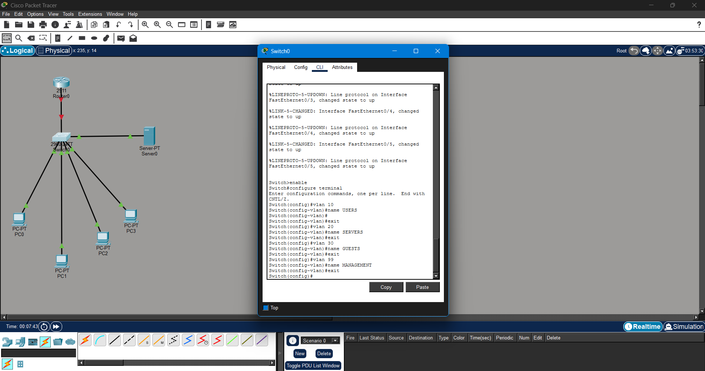

### Switch access-port assignment and trunk configuration commands

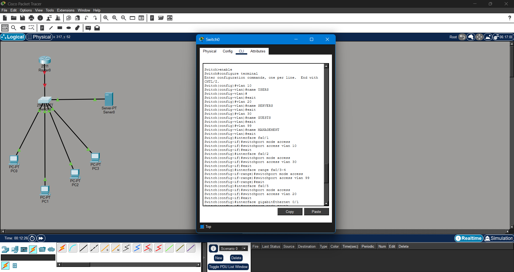

### Switch VLAN table: VLANs 10, 20, 30 and 99 with access ports

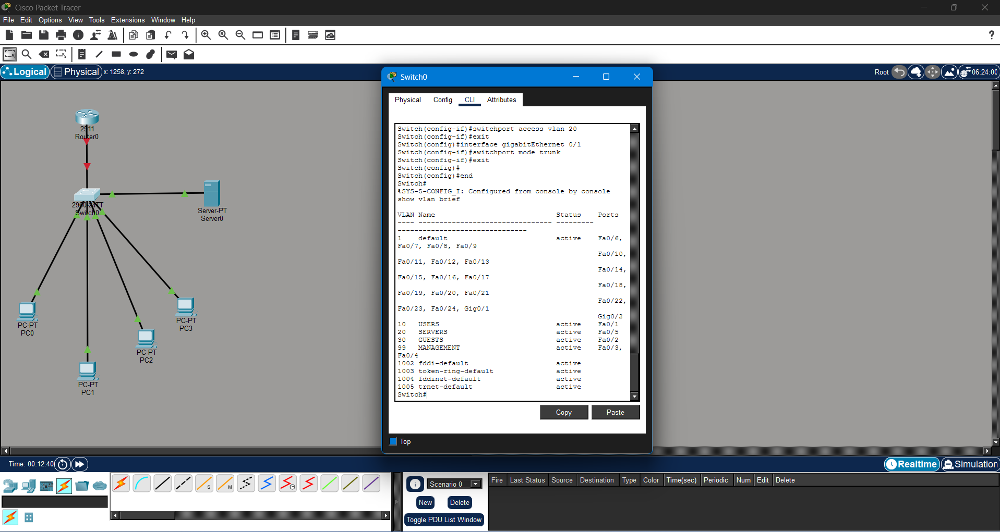

### Router-on-a-Stick subinterface configuration commands

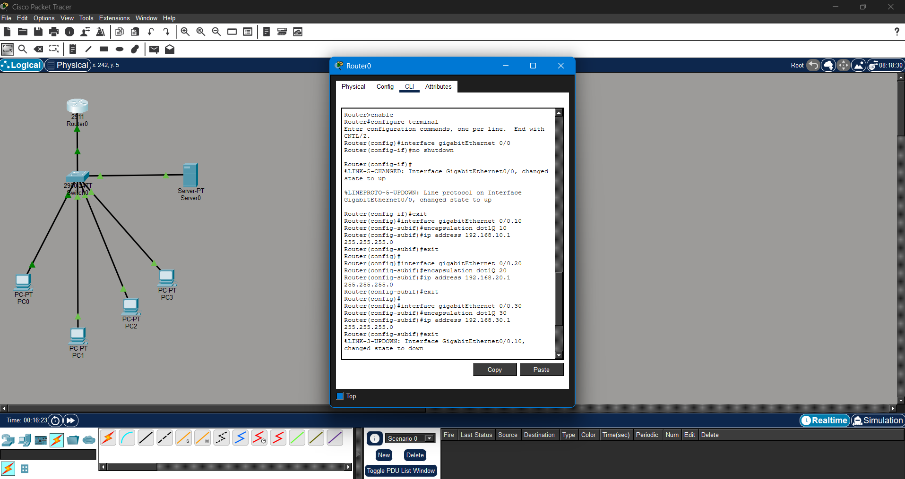

### Router interface summary; VLAN 99 subinterface is absent from this output

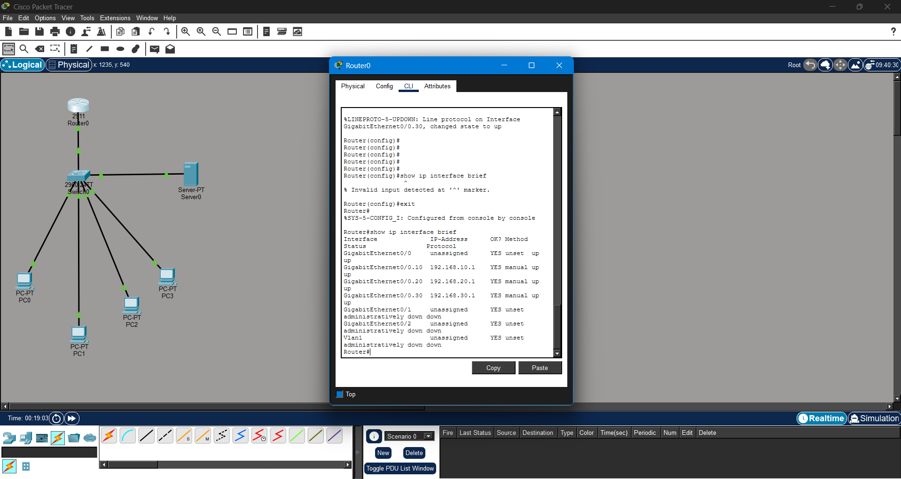

### PC0 Users VLAN static IPv4 configuration

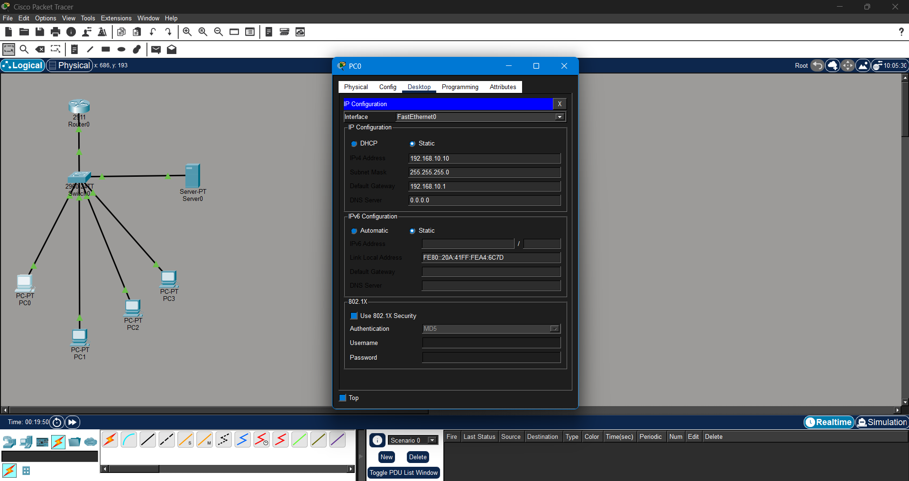

### PC1 Guest VLAN static IPv4 configuration

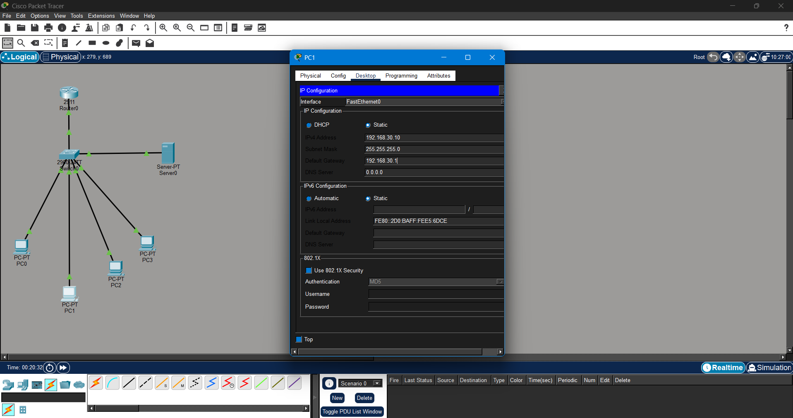

### PC2 Management VLAN static IPv4 configuration


### PC3 Admin host static IPv4 configuration

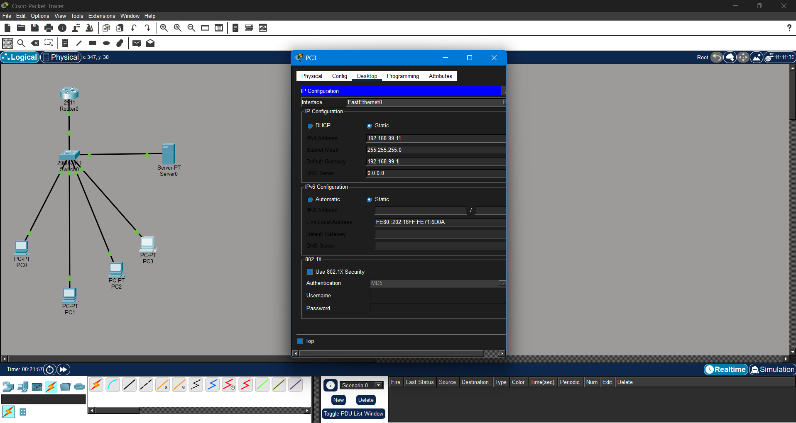

### Server0 static IPv4 configuration


### Pre-ACL baseline ping tests from PC0; initial ARP-related first-packet timeouts followed by replies

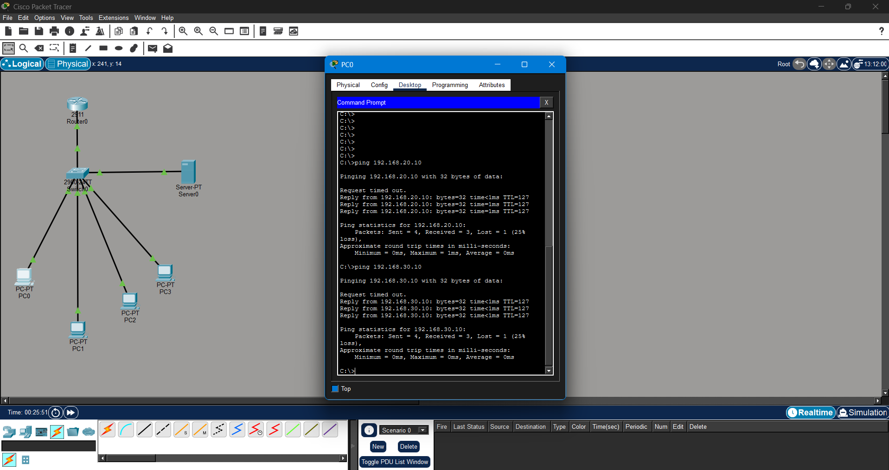

### Extended ACL GUEST-IN configuration and inbound application on G0/0.30

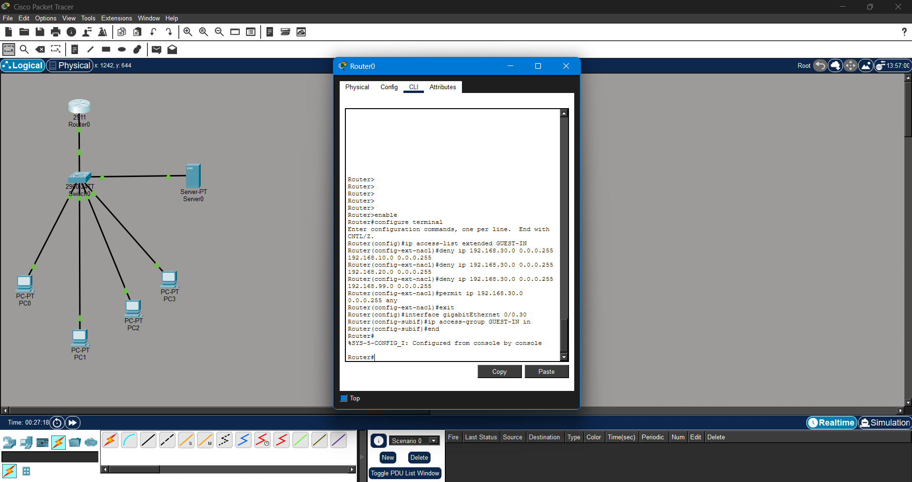

### Guest host ping tests to Users, Server and Management destinations blocked

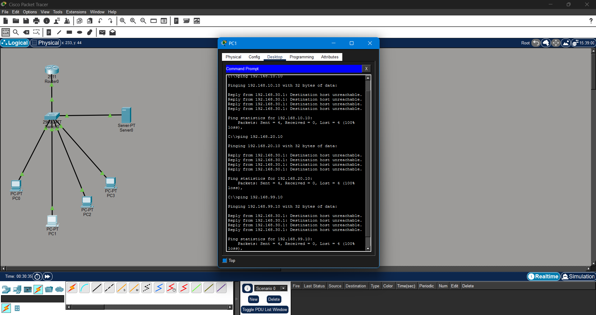

### Post-ACL authorized PC0-to-Server ping succeeds 4/4

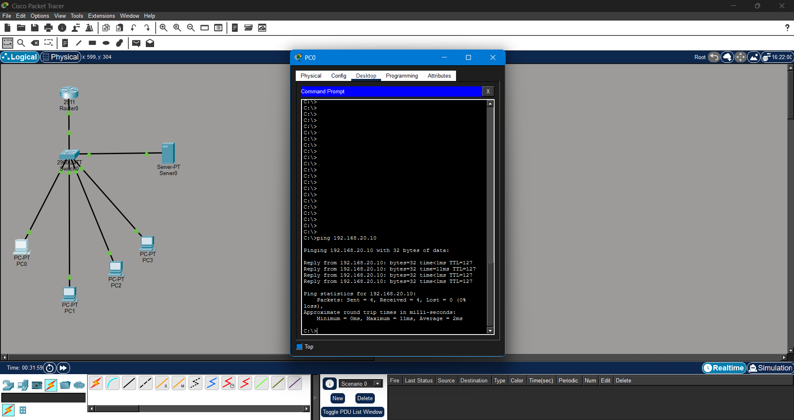

### ACL counters show four matches on each deny entry; interface summary also shows missing VLAN 99 subinterface

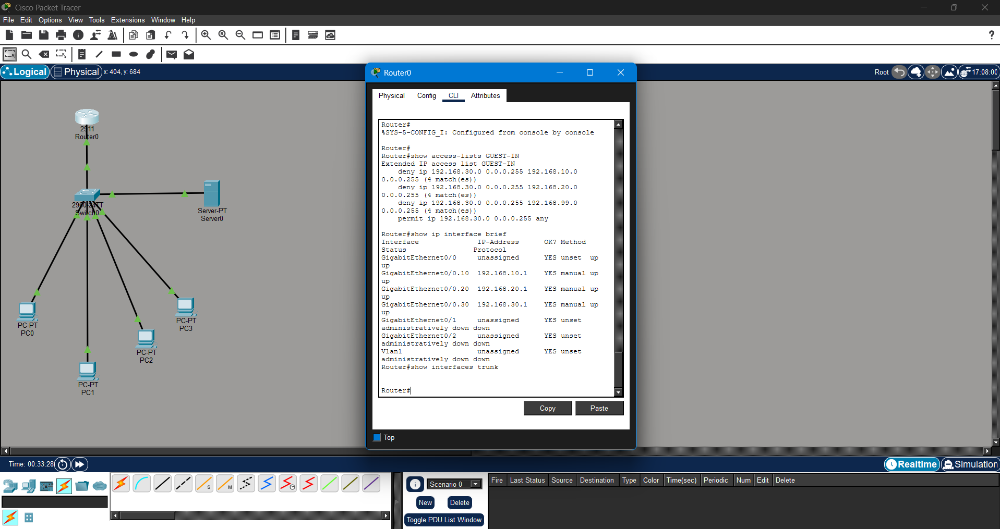

## 8. Final status

**Partially completed.** The VLANs and access-port assignments are documented, the Guest inbound ACL is configured, and the captured tests show Guest-to-internal traffic blocked while Users-to-Server traffic remains successful. The Management VLAN gateway (G0/0.99) is missing from the captured router interface summary and must be configured/verified. The switch trunk status should also be captured from Switch0. Complete those checks and add the resulting screenshots before changing this report status to Completed.
